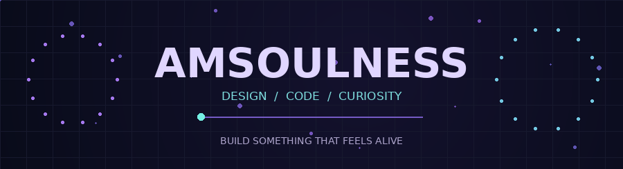
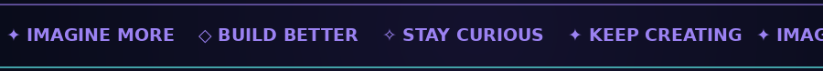
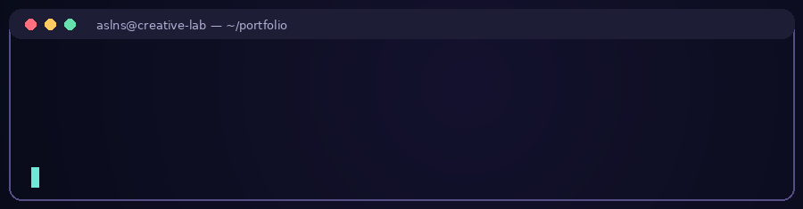
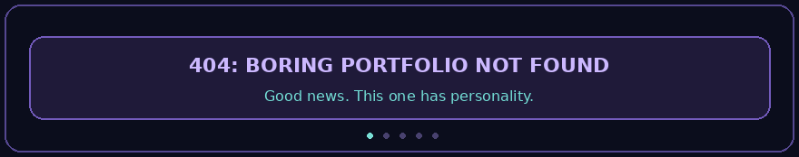
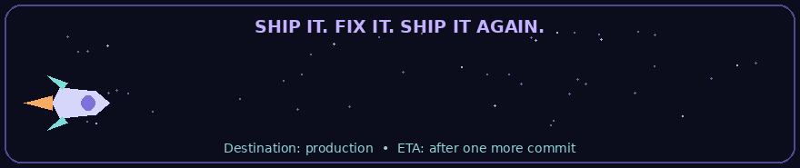

<div align="center">



# Hey, I'm Emmanuel 👋

### 

**`Building things that look good, work well, and occasionally surprise me.`**

<a href="https://aslns.online"></a>
<a href="https://aslns.online/tools"></a>
<a href="https://github.com/amsoulness/portfolio"></a>


<br/>


</div>

---

## ✦ The human behind the commits

I'm **Emmanuel Cherian**, a BCA student in Kerala, India, working toward a career in **software development**.

I enjoy making practical web experiences, exploring new technologies, and figuring out *why that one line of code broke everything*. My sweet spot is the intersection of **creative interfaces**, **useful tools**, and **problem-solving**.

- 🎓 **Studying:** Bachelor of Computer Applications (BCA), expected graduation **2027**
- 🧑‍💻 **Interested in:** Software development, modern web apps, automation, and cybersecurity
- 🛠️ **Currently building:** [ASLNS Portfolio](https://aslns.online) and its [Tools Hub](https://aslns.online/tools)
- 🌱 **Learning mindset:** Build → break → debug → improve → repeat
- 💬 **Languages:** English, Malayalam, Hindi, and Tamil
- ⚡ **Fun fact:** My browser has more tabs than my code has comments. The tabs insist they're all important.

<div align="center">



</div>

## 🧰 My developer toolkit

<div align="center">

**Languages**


**Frameworks & tools**


</div>

> I don't collect technologies just to fill badges. I like learning enough to actually build something with them. (The icons are just here because they look tidy.)

<details>
<summary><strong>🧪 Open the tiny developer status console</strong></summary>

```text
[ OK ] Curiosity .............. RUNNING
[ OK ] New ideas .............. QUEUED
[ ?? ] CSS layout ............. MOVING ON ITS OWN
[ OK ] Debugging .............. COFFEE-ASSISTED
[....] Becoming a better dev .. IN PROGRESS
```

Current workflow:

```text
Idea → build → “why is it purple?” → debug → ship → repeat
```

</details>

## 🚀 Featured project: ASLNS

<div align="center">

### [aslns.online](https://aslns.online)

**A personal corner of the internet where design meets code.**

[**Explore the portfolio**](https://aslns.online) · [**Try the tools**](https://aslns.online/tools) · [**Browse the source**](https://github.com/amsoulness/portfolio)

</div>

Built with **React, TypeScript, and Vite**, ASLNS brings together my portfolio and a collection of browser-friendly utilities.

| ✨ Tool | What it does |
|:--|:--|
| 💬 WhatsApp Profile Updater | Guided profile-photo update flow with full-image preview |
| 🖼️ Image Studio | Compress images and convert formats |
| 🔳 QR Code Studio | Create and export QR codes |
| 🎨 Color Lab | Explore colors and palettes |
| 🔐 Password Studio | Generate secure passwords |

<div align="center">

</div>

## 🧪 Other things I've built and explored

**WhatsApp Automation Bot** — An academic project using **Java and Python**, exploring automated replies and status-related features.

**Cybersecurity internship** — Experience at **Adzink Studio** (March–May 2026), expanding my interest in security and practical development.

I'm interested in projects that solve real problems—even small ones. Especially the ones that start with *“This should only take five minutes.”*

<details>
<summary><strong>🪲 A completely accurate bug report</strong></summary>

> **Expected:** A quick, tiny change.  
> **Actual:** Three tabs, six edits, one snack break, and a new appreciation for semicolons.  
> **Priority:** High (the button is 2 pixels off).

</details>

## 📊 GitHub, in motion

<div align="center">


<br/>


</div>

<sub>These stats are provided by third-party services and may occasionally be unavailable. Language percentages reflect public repository code, not overall proficiency.</sub>

## 😂 The very serious developer department

<div align="center">



</div>

```text
$ git status
On branch: figuring-it-out
Changes not staged for commit:
  modified: sleep_schedule.txt
  modified: one_more_feature.tsx

$ git commit -m "final final version (actually final)"
```

## 🎯 What's next?

- Make ASLNS more polished, accessible, and useful
- Keep growing my collection of small developer tools
- Build projects that strengthen my full-stack skills
- Learn, collaborate, and become a better software developer

<div align="center">



### ✦ Keep creating. Keep experimenting. Keep shipping.

**Thanks for stopping by!**

[**🌐 Portfolio**](https://aslns.online) · [**🛠️ Tools Hub**](https://aslns.online/tools) · [**💻 Repositories**](https://github.com/amsoulness?tab=repositories)

<sub>Crafted with curiosity · Powered by caffeine · Signed ASLNS</sub>

</div>